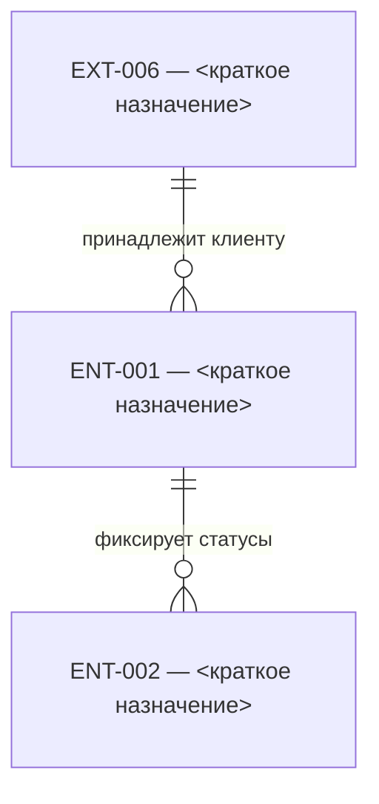

# Шаблон: модель данных

Как устроен комплект модели данных сервиса и по какому формату описывается каждая сущность.

## Состав комплекта

```
docs/srs/data-model/
├── README.md                    # обзор: назначение, формат атрибутов, ER-диаграмма, реестр сущностей
├── dictionaries.md              # общие справочники, внешние зависимости EXT, настраиваемые параметры
└── ent-NNN-<имя>.md             # по одному файлу на сущность (ent-001-request.md, …)
```

Правила:

- **Модель данных ведётся на ЛОГИЧЕСКОМ уровне** (решение методолога, 2026-08-11): сущности, атрибуты с логическими типами, обязательность и уникальность значений, связи. Физическая реализация — таблицы, физические типы, ключи (PK/FK), default, DDL — зона разработки и в модели не проектируется; из физики в модели только **привязка к реализации** («Физ. имя», «Таблица БД») по фактам постановки. Ранее выпущенные комплекты физического формата не переконвертируются. Поведение — когда запись создаётся и меняется, прикладные контроли, правила заполнения — предмет описания функций и раздела «Контроли», в модели данных его нет.
- **Все атрибуты сущности из постановки.** Логическая модель включает и атрибуты, чьи значения хранятся вне БД (например, содержимое файла на файловом сервере): место хранения — способ реализации, не основание исключать атрибут (решение методолога, 2026-08-11); формулировка о месте хранения из постановки переносится в «Описание» дословно. **Не включаются** только константы и вычисляемые значения, не являющиеся данными сущности, — каждый такой случай подсвечивается аналитику (в списке спорных мест).
- **Одна логическая сущность — один файл.** В файле описываются только атрибуты самой сущности; атрибуты связанных сущностей не включаются — каждой связанной сущности отводится свой файл, связь описывается в разделе «Связи». Как сущность реализована в БД (своя таблица, вариант наследования, M:N через таблицу связи) — выбор разработки, состава логической модели он не меняет. Файл самодостаточен: читается без открытия других документов. Исключение: легенда обозначений колонок — в обзоре README; в entity — ссылка на `README.md#обозначения`.
- Имя файла: `<id>-<короткое-имя-латиницей>.md` (conventions §5) (например `ent-001-request.md`).
- Стабильный ID атрибута — `ENT-NNN.«Бизнес-название»` (ID сущности + название атрибута дословно) — единая нотация во всех слоях: тексты SRS (conventions §5), API-артефакты, тесты. Отдельные номера атрибутам не присваиваем; параллельного «физического» ID нет. «Физ. имя» — необязательная привязка к реализации: её пустота — нормальное состояние логической модели, не долг и не спорное место. Переименование атрибута в постановке — каскадная правка всех ссылок в том же изменении.
- Спорные места (тип «На усм. арх.» в Confluence, противоречия между страницами Confluence) — **не решаем молча**: собираем списком и выносим аналитику; до решения в документ пишем значение по приоритету источников ([conventions.md](https://gitlab.gboteam.ru/ED/eco-techbook/-/blob/master/standards/analytics/conventions.md) §1).
- **Весь файл шаблона** — без markdown-ссылок `[текст](путь)`; места, где в целевом документе output нужна ссылка, помечаются `<ссылка […](…)>`. Имена файлов без markdown-ссылки — в backticks: `dictionaries.md`, `README.md#…`, `ent-…-….md`.

## Шаблон README.md (обзор модели)

````markdown
---
id: DM-000
title: '<дословное наименование из title главной страницы-источника>'
type: data-model
service: <service-id>
confluence_page_ids: [<ID страниц-источников, главная первой; только reverse>]
---

# Модель данных

<Абзац: что хранит сервис. Центральная сущность — <ссылка [ENT-001 <название>](ent-…-….md)>; в составе агрегата — <ссылка [ENT-00N <название>](ent-…-….md)>, … Ссылки на данные платформы — в реестре <ссылка [dictionaries.md](dictionaries.md)>; сущности хранят идентификаторы и денормализованные снимки реквизитов.>

<Опционально: общие соглашения по именованию таблиц, например префикс `eco_`.>

## Формат атрибутов сущностей

Единый формат таблиц атрибутов во всех файлах ent-*.md.

### Колонки таблицы атрибутов

| Колонка | Содержание |
|---|---|
| Атрибут | Бизнес-название атрибута (дословно из постановки); основа стабильного ID `ENT-NNN.«Атрибут»` |
| Физ. имя | Привязка к реализации (имя колонки/поля), если известна из постановки; пусто — норма |
| Тип | Логический тип данных дословно из постановки (GUID, Строка (64), Дата и время, Логический…) |
| Обяз. | Обязательность значения: Да / Нет / — |
| Уникальность | Уникальность значения: Да / Нет / — |
| Описание | Смысл хранимого значения; допустимые значения из справочников — со ссылкой на справочник; явный default постановки — дословно («Значение по умолчанию: …») |

Бизнес-форматы и прикладные контроли полей — в функциях и разделе «Контроли».

### Обозначения

В колонках «Обяз.» и «Уникальность»: **Да** / **Нет** — как в постановке; **—** — в постановке не задано. Физические обозначения (PK, FK, NOT NULL, default) в логической модели не используются.

## ER-диаграмма

Схема отражает все связи из разделов «Связи» файлов сущностей. Узлы `EXT-NNN` — зависимости платформы из <ссылка [dictionaries.md](dictionaries.md)>. Подпись ребра — смысл связи с точки зрения сущности сервиса (ENT), как в колонке «Связь» файла сущности.



Зависимости `EXT-NNN`, используемые только в атрибутах (без строки в «Связи»), на диаграмме не показываются — см. <ссылка [dictionaries.md](dictionaries.md)>. Кратности и ключи — в разделах «Связи» файлов сущностей.

## Сущности

| ID | Сущность | Назначение | Привязка к реализации |
|---|---|---|---|
| <ссылка [ENT-001 <название>](ent-…-….md)> | <название> | <краткое назначение> | `<имя_таблицы>` |
| <ссылка [ENT-002 <название>](ent-…-….md)> | <название> | <краткое назначение> | — |

## Справочники и вспомогательные документы

| Документ | Содержание |
|---|---|
| <ссылка [dictionaries.md](dictionaries.md)> | справочники и перечисления, сущности и справочники платформы EXT-001…EXT-NNN, настраиваемые параметры |
````

## Правила ER-диаграммы

ER-диаграмма в `data-model/README.md` — обзорная схема связей комплекта. Поддерживается в актуальном состоянии вместе с моделью.

- **Источник истины:** разделы «Связи» всех `ent-*.md` и реестр `EXT-NNN` в `dictionaries.md`.
- **Уровень — логический:** рисуем связи постановки, не таблицы БД. Связь M : N изображается прямо (`}o--o{`) — промежуточная таблица связи не изобретается; наследование/специализация — связь с подписью «является видом» либо атрибут-дискриминатор со справочником. Совпадения диаграммы с физической схемой БД не требуется.
- **Что рисуем:** каждая **уникальная** связь из разделов «Связи», где в колонке «Сущность» указаны ENT или EXT, — одно ребро на диаграмме. Зеркальные строки ENT↔ENT в разных файлах сущностей (одна пара с обратной формулировкой) — **одно** ребро; предпочтительный источник формулировки — файл агрегата (центральная сущность сервиса).
- **Что не рисуем:** EXT, используемые только в атрибутах (нет строки в «Связи»).
- **Когда обновлять:** при добавлении/удалении сущности, при изменении раздела «Связи» любого entity, при добавлении EXT со строкой в «Связи».
- **Где обновлять:** `data-model/README.md` → `## ER-диаграмма` — в том же изменении, что и правки entity.
- **Синтаксис mermaid:** ID узлов — латиница с подчёркиванием (`ENT_001`, `EXT_008`); подпись узла — в кавычках, формат `ENT-NNN — краткое назначение`; подпись ребра — краткий смысл связи с точки зрения **сущности сервиса (ENT)**, как в колонке «Связь» файла сущности (для агрегата — преимущественно файл центральной сущности); порядок узлов в строке mermaid на уникальность связи не влияет; сначала объявить все узлы, затем связи.
- **Проверка:** число рёбер на диаграмме = число **уникальных** связей из разделов «Связи». Алгоритм: нормализовать каждую строку к паре узлов; для ENT↔ENT — неориентированная пара; для ENT→EXT — ориентированная; дубликаты не суммировать.

## Шаблон dictionaries.md (справочники и параметры)

Общие справочники, перечисления, зависимости платформы и настраиваемые параметры — в одном файле, три раздела H2 в указанном порядке:

````markdown
---
id: DM-001
title: '<дословное наименование из title главной страницы-источника>'
type: data-model
service: <service-id>
confluence_page_ids: [<ID страниц-источников, главная первой; только reverse>]
---

# Справочники и параметры модели данных

## Общие справочники модели данных

Справочные значения и перечисления, на которые ссылаются атрибуты сущностей.

### <Справочник, например «Статусы заявки»>

Где используется: <ссылка [ENT-NNN <название>](ent-…-….md)>.`<поле>`, <ссылка [ENT-MMM <название>](ent-…-….md)>.`<поле>` (хранится <строковый/числовой> код).

Реализация: <способ ведения набора, если задан постановкой; иначе «способ хранения набора не зафиксирован»>.

| Код | <Название / другие колонки> |
|---|---|
| `<КОД>` | <…> |

<Для справочника статусов: справочник — единственный каталог статусов (диаграмма переходов — не здесь, а в статусной модели, шаблон `status-model.md`); добавить ссылку на неё: «Диаграмма переходов — в <ссылка [статусной модели](../process/status-model.md)>».>

## Справочники и сущности платформы

Данные, ведущиеся на платформе вне сервиса: справочники и сущности платформы. Сервис только читает их по ссылке.

### Реестр

| ID | Справочник | Где ведётся | Использование в сервисе | Внешний репозиторий |
|---|---|---|---|---|
| EXT-001 | <Справочник валют> | <платформенный сервис справочников> | <ссылка [ENT-NNN <название>](ent-…-….md)>.`<поле>` | |
| EXT-006 | <Клиент Банка> | платформа | <ссылка [ENT-NNN <название>](ent-…-….md)>.`<поле>`; связь ENT-NNN → EXT-006 | |

## Настраиваемые параметры

Параметры конфигурации, используемые сервисом. **Источник истины — этот документ:**
значение параметра в среде меняется только вместе с изменением документации (conventions §5.2).

| Параметр | Значение | Назначение |
|---|---|---|
| `<имя_параметра>` | `<значение>` | <что определяет, какой атрибут затрагивает `ENT-NNN.поле`> |
````

Каждой платформенной зависимости присваивается ID `EXT-NNN` (справочник или сущность платформы). В описаниях атрибутов и в разделе «Связи» — <ссылка [EXT-NNN <название>](dictionaries.md#реестр)>, а не текст «внешняя» без ссылки. Отсутствующую запись добавляют в реестр.

Правила справочных данных:

- **Перечисление или справочник сервиса** (любое количество сущностей) — раздел `###` в `dictionaries.md` → `## Общие справочники`; фиксируем **полный** набор значений. Перед таблицей значений — блок **«Где используется»** (ссылки на `ENT-NNN.<поле>`) и строка **«Реализация»** на отдельной строке после пустой строки. Если коды хранятся в атрибутах сервиса — таблица кодов здесь; пометка «платформенное» не используется.
- **Справочник или сущность платформы** — `dictionaries.md`, реестр `EXT-NNN`; значения справочников не дублируются.
- **Настраиваемый параметр** — раздел `## Настраиваемые параметры` в `dictionaries.md` со значением (docs-first, conventions §5.2).
- У перечисления после пустой строки указываем строку `Реализация:` — способ ведения набора по постановке; не задан — «способ хранения набора не зафиксирован».
- Тексты интерфейса — в экранных формах, не в справочниках.

## Шаблон файла сущности

````markdown
---
id: ENT-001
title: '<дословное наименование из title главной страницы-источника>'
type: data-model
service: <service-id>
confluence_page_ids: [<ID страниц-источников, главная первой; только reverse>]
---

# ENT-001. <Название сущности>

<2–3 предложения бизнес-языком: какую информацию хранит сущность и зачем она нужна.>

<Если страница-источник ведёт паспорт-таблицу жизненного цикла
(«Назначение / Использование сущности / Когда создается запись /
Когда изменяется запись» и т.п.) — она переносится сюда ДОСЛОВНО
таблицей (Э-1 экзамена inkasso, решение 2026-08-18: это факты
постановки о жизненном цикле данных, читателю модели они нужны).
Упомянутые в ней функции — по правилу трёх случаев (целевая карточка /
долг в матрице); поведение самих функций здесь не пересказывается.>

## Привязка к реализации

| Параметр | Значение |
|---|---|
| Таблица БД | `<имя_таблицы>` |

<Раздел — привязка, а не проектирование: только факты постановки (например,
строка «Наименование таблицы в БД - …»); не задано — «—». Ключи, индексы,
DDL — зона разработки, здесь не описываются. Идентифицирующий атрибут виден
по колонкам «Обяз.» = Да и «Уникальность» = Да.>

## Атрибуты

Формат колонок и <ссылка [обозначения](README.md#обозначения)> — в обзоре модели данных.

<Атрибуты группируются тематическими секциями (как удобно читать аналитику),
внутри секции — таблица одного формата. Только логическая структура;
прикладные контроли и правила заполнения — в функциях и `control/`.

У секции может быть преамбула — 1-2 предложения, если у блока есть общая семантика:
- денормализация: «Денормализованная копия реквизитов внешней сущности „X" на дату …»;
- условие наличия блока: «Блок заполняется только при <атрибут> = TRUE» /
  «…только для типа счёта 2 <ссылка [справочник](dictionaries.md#<якорь>)>»;
- этап появления данных: «Заполняются в ходе исполнения заявки; до исполнения пусты»;
- разделение хранения: «Прочие реквизиты X — в отдельной сущности ENT-NNN».
Общее правило для условий: ссылаться на конкретные КОДЫ справочника, а не на словесные
названия («тип счёта 2», не «счёт исполнителя ГОЗ») — иначе условие не сопоставимо машинно.>

### <Тематическая секция, например «Базовые реквизиты заявки»>

| Атрибут | Физ. имя | Тип | Обяз. | Уникальность | Описание |
|---|---|---|---|---|---|
| Номер заявки | `doc_number` | Число | Да | Да | |
| Дата заявки | | Дата и время | Да | Нет | |

<«Тип» — логический тип дословно из постановки. «Обяз.»/«Уникальность» —
Да/Нет как в постановке; не задано — «—». «Физ. имя» — только если названо
в постановке (например, в скобках названия); пусто — норма. **Готовая
таблица маппинга источника** («Наименование поля ↔ Наименование поля в
БД» и т.п., Э-2 экзамена inkasso) раскладывается ПОСТРОЧНО в колонку
«Физ. имя» соответствующих атрибутов; расхождение русских имён маппинга
с именами атрибутов — спорное место, не повод бросить маппинг. Явный
default постановки — дословно в «Описании» («Значение по умолчанию: False»).
«Описание» — смысл данных (что хранится), без поведения и правил заполнения.
Бизнес-форматы (длины, допустимые символы, диапазоны) — прикладные контроли,
их место в `control/`: **колонка ФЛК источника и содержимое «Пример:»
в модель НЕ переносятся** (гейт их не требует — механический фильтр,
Э-3), но судьба ФЛК не молчалива: непустая колонка ФЛК у страницы МД =
ОБЯЗАТЕЛЬНЫЙ долг в матрице «прикладные контроли атрибутов ENT-NNN
(колонка ФЛК страницы МД) — требуется дозаход create-controls».

Образец выреза примера (решение 2026-08-18; абзац примера удаляется
ЦЕЛИКОМ, не только маркер — механический сторож проверяет ОТСУТСТВИЕ
значений примеров в карточке):
источник (ячейка «Описание»):
«Назначение платежа с указанием ст ФЗ 164…</p><p>Пример: В
соответствии с п. 1 ст. 13 ФЗ … НДС в том числе 20%</p><p>Реквизит
№24 в 762-П.</p>»
карточка: «Назначение платежа с указанием ст ФЗ 164… Реквизит №24 в
762-П.» — значение примера удалено целиком (частичный вырез оставляет
хвост «…1 ст. 13 ФЗ…» — брак), пометки-реквизиты источника остаются,
склеек абзацев без пробела («…20%Реквизит…») нет.>

## Связи

| Связь | Сущность | Кратность | Ключ связи | Комментарий |
|---|---|---|---|---|
| Заявка → История изменений | <ссылка [ENT-002 <название>](ent-…-….md)> | 1 : N | «ID заявки» в ENT-002 | история статусов заявки |
| Заявка → Клиент Банка | <ссылка [EXT-006 <название>](dictionaries.md#реестр)> | N : 1 | «ID Клиента» | |
| Заявка → Тариф | <ссылка [ENT-003 <название>](ent-…-….md)> | M : N | — (по постановке) | реализацию связи выбирает разработка |

Кратность — **логическая**, по постановке; согласуется с колонками ключевого
атрибута: «Обяз.» = Да → `1`, иначе `0..1`; сторона владельца ключа — `N`,
при «Уникальность» = Да — `0..1`. Связь M : N записывается прямо — таблица
физической связи не изобретается (её реализация — зона разработки).
Значения из примера не переносить.

Колонка «Сущность» — **всегда ссылка** с наименованием: <ссылка [ENT-NNN <название>](ent-…-….md)> или <ссылка [EXT-NNN <название>](dictionaries.md#реестр)>. Текст «внешняя» без ссылки не используется.

«Ключ связи» — атрибут (по бизнес-названию), через который связь существует
в данных; для M : N без атрибута-ссылки — «—».

Раздел «Связи» — **единственное** место описания связей сущности; в «Привязке
к реализации» связи не дублируются. Принадлежность агрегату отмечается в
комментарии связи («в составе агрегата <сущности>»).
````

Ссылки на справочники — в описаниях атрибутов («Допустимые значения — …») со ссылкой на `dictionaries.md#<якорь>` или <ссылка [EXT-NNN <название>](dictionaries.md#реестр)>.

## Логический уровень — зона аналитика; физическая реализация — зона разработки

- **Аналитик ведёт логическую модель**: состав сущностей, атрибуты, обязательность/уникальность, связи, справочники. Она первична и не зависит от способа реализации: логический уровень может не мапиться на физику один к одному (варианты реализации наследования, M:N через таблицу физических связей 1:N). ID атрибута `ENT-NNN.«Бизнес-название»` существует с первого дня и не зависит от кода.
- **Физическую реализацию выбирает разработка**: таблицы, ключи, индексы, способ реализации наследования и M:N. Привязка («Физ. имя», «Таблица БД») фиксируется в модели по фактам постановки — аналитик её не проектирует.
- **Артефакты реализации в SRS не включаются**: имена классов, пути в коде, названия модулей — это результат этапа разработки, аналитик их не знает и не описывает.
- **Технический журнал событий (аудитный event-лог) не включается**: сущность вида «События заявки» (таблица `*_event`, поля `event_type`/`params`/`parameters`, платформенный `EventEntity`) и справочник «Типы событий заявки» — техническая инфраструктура аудита, аналитик её не проектирует. Не выгружать из кода и не описывать. Значимую для аналитики историзацию (смена статусов и т. п.) ведёт отдельная сущность «История изменений».
- При reverse-восстановлении источник — **логический уровень**: страницы «МД» выгрузки Confluence (раздел «Правила заполнения колонок атрибутов» ниже); код источником не является. Документ пишется так, будто аналитик спроектировал модель сам: без ссылок на код и Confluence ([conventions.md](https://gitlab.gboteam.ru/ED/eco-techbook/-/blob/master/standards/analytics/conventions.md) §5).

## Правила заполнения колонок атрибутов (reverse)

Источник — страницы сущностей раздела «МД» выгрузки Confluence: описание
сущности, строка «Наименование таблицы в БД - …», таблица «Атрибутный состав
сущности» (`№ п/п | Наименование | Тип данных | Обязательность | Уникальность
| Описание`). Код источником не является. Формат шаблона намеренно повторяет
формат источника — перенос близок к дословному.

| Колонка шаблона | Откуда | Правило |
|---|---|---|
| Атрибут | Наименование | бизнес-название дословно; физимя в скобках («Ссылка на файл (attachment_id)») → в «Физ. имя», из «Атрибута» снимается |
| Физ. имя | скобки названия или отдельная колонка источника | нет в источнике — пусто (норма, не долг) |
| Тип | Тип данных | **логический тип дословно** («GUID», «Строка (64)», «Дата и время»); в физический не переписывать |
| Обяз. | Обязательность | Да/Нет дословно; не задано — «—» |
| Уникальность | Уникальность | Да/Нет дословно; не задано — «—» |
| Описание | Описание | по алгоритму ниже; явный default источника — дословно («Значение по умолчанию: …») |

- Строка «Наименование таблицы в БД - …» страницы → «Привязка к реализации» (дословно, с регистром источника); нет — «—».
- Колонка «№ п/п» источника не переносится — порядок строк сохраняет её роль.
- Атрибут-ссылка (в названии/описании — «Ссылка на …», «ID …» другой сущности) — ссылка на ENT/EXT в «Описании», связь — в разделе «Связи»; ключи БД из этого не выводятся.
- Сырая HTML-таблица атрибутного состава — только через нормализатор (проход 1, [`source-parsing.md`](../tools/source-parsing.md)); счётная сверка: строк в карточке = строк в источнике.

### Алгоритм заполнения колонки «Описание»

Колонка отвечает на один вопрос: **что означает хранимое значение?**

1. **Проверка на пустоту.** Если бизнес-название атрибута полностью отвечает на вопрос — оставить пусто. Пересказывать название другими словами запрещено. **Исключение:** атрибут-ссылка («Ссылка на …» / «ID …» другой сущности в названии) — в «Описании» обязательна ссылка на целевую сущность или EXT.
2. **Заполнять обязательно**, если есть хотя бы одно из:
   - ссылка на другую сущность или внешнюю зависимость → <ссылка [ENT-NNN …](ent-…-….md)> или <ссылка [EXT-NNN …](dictionaries.md#реестр)>; уточнения (пусто при автомате, уникальность и т. п.) — после ссылки через «;»;
   - семантика значений boolean/кодов — **всегда оба значения**, каждое с новой строки (перенос в ячейке — `<br>`): «TRUE — …;<br>FALSE — …». Если источник описывает только одно состояние — семантику второго НЕ выводить из здравого смысла: записать нейтрально по факту («FALSE — проверка не зафиксирована»), а вопрос недоописанного состояния — в спорные места/OQ (дыра постановки — решение владельца требований, инцидент «Проверен DLP», 2026-08-12);
   - значения из справочника → с указанием колонки: «Допустимые значения — колонка «Код» справочника <ссылка [Типы счетов](dictionaries.md#типы-счетов)>» или «<ссылка [EXT-001 <название>](dictionaries.md#реестр)>» для платформенных; для снимков добавлять момент фиксации: «…; фиксируется на момент создания заявки»;
   - смысловое условие наличия значения («пусто, если заявка создана обычным путём»);
   - для дат и снимков — определение момента фиксации («момент перехода в статус EXECUTED», «на момент создания заявки»).
Однотипные атрибуты (например, серия хешей текстов согласий) описываются **одной и той же формулировкой** — не вариациями.

3. **Запрещено:**
   - поведение и логика заполнения — кто, когда и откуда заполняет поле, правила уникальности уровня приложения (место — описания функций);
   - происхождение значения при денормализации («= Клиент Банка.X» — это тоже логика заполнения);
   - расшифровка аббревиатур и указание систем-источников (место — глоссарий);
   - прикладные контроли (место — `control/`);
   - пересказ названия, типа или физ. имени;
   - ссылки на источники.

Граница «данные vs поведение»: описываем, *что значение означает*, а не *как система его записывает*. Если описание источника содержит поведение («по достижению этого срока файл удаляется») — его НЕ пересказывают и НЕ отбрасывают молча: семантику значения оставить, а поведенческую часть вынести в список спорных мест с вопросом «описано ли в функциях/процессах?» (инцидент «Срок действия», file-storage, 2026-08-11: молчаливый пересказ исказил смысл и потерял «независимо от статуса обработки»).

Бизнес-обязательность, бизнес-форматы (длины, допустимые символы, диапазоны), прикладные контроли и правила заполнения, найденные в источниках, **не теряем** — они пойдут в описания функций и раздел «Контроли» на соответствующих фазах.

Напоминание: источники — рабочий материал; в готовом документе ссылок на них быть не должно (conventions §5).

## Проектирование с нуля (forward-режим)

Когда SRS пишется до кода, агент-аналитик не извлекает физмодель, а **проектирует** её. Правила проектирования:

### Нейминг

- Сущности и атрибуты — бизнес-названиями, уникальными в пределах сущности; булевы признаки — утвердительной формой («Признак подключения интернет-банка», не «Признак отсутствия…»).
- «Физ. имя» и имена таблиц аналитик в forward не задаёт — привязка появится от разработки и фиксируется в модели как факт.
- Название атрибута — основа стабильного ID: после акцепта переименование только каскадной правкой всех ссылок.

### Технические атрибуты

Технический каркас записей (суррогатный `id`, версия для оптимистической
блокировки, служебные отметки времени) — зона разработки: в логическую модель
не включается. Бизнес-значимые даты («Дата и время создания» из постановки) —
обычные атрибуты модели.

### Проектные паттерны (когда что применять)

| Ситуация | Паттерн |
|---|---|
| Значение должно быть юридически/исторически зафиксировано на момент события (реквизиты в документе, хеш текста согласия) | **Снимок** (денормализация): копия значения + преамбула секции «на момент …»; живая ссылка (атрибут «ID …») сохраняется рядом |
| Закрытый набор значений, управляемый сервисом | **Перечисление** в `dictionaries.md` → `## Общие справочники` |
| Закрытый набор, несколько сущностей | то же — все перечисления в `dictionaries.md` |
| Набор значений ведёт платформа (валюты, типы счетов) | **Справочник платформы** EXT-NNN в `dictionaries.md` |
| Значение задаётся администратором и влияет на поведение (хеши согласий, фиче-флаги) | **Настраиваемый параметр** в dictionaries.md |
| Данные с собственным жизненным циклом при главной сущности (история, документы, подпись, события) | **Агрегат**: отдельная сущность + связь через ключевой атрибут, комментарий «в составе агрегата» в связях |
| Признак «да/нет» с двумя осмысленными состояниями | атрибут типа «Логический», обязательный; если состояний три и больше — код + справочник, не логический признак |

### Вопросы, которые агент обязан задать до проектирования

Если ответа нет во входных требованиях — задать аналитику/заказчику (не предполагать молча):

1. Какие атрибуты обязательны для бизнеса? Что уникально (и в каком разрезе)?
2. Откуда берутся значения: вводит пользователь / копируются из внешней сущности / присваивает смежная система?
3. Что должно быть зафиксировано «на момент события», а что — жить ссылкой?
4. Какие наборы значений закрытые (справочники) и кто ими управляет?
5. Что должно настраиваться без доработки (параметры)?
6. Нужна ли история изменений / аудит действий?

## Приложенные артефакты (при наличии)

Если у страницы-источника есть не-markdown приложения (схема
внутренней структуры данных и т.п.) — карточка несёт блок
«Приложенные артефакты» по `attachments-block.md`: файл в `files/`
рядом с карточкой, ссылка обязательна, роль заполнена.

## Чек-лист самопроверки (до отправки MR на ревью)

- [ ] Frontmatter заполнен (id, type, service).
- [ ] В документе нет ссылок на Confluence, код и `sources/*` (conventions §5); источники перечислены в сообщении коммита.
- [ ] Все атрибуты из Confluence-страницы сущности перенесены (или их отсутствие объяснено); счётная сверка строк с источником выполнена.
- [ ] Атрибуты, хранимые вне БД, включены (место хранения — дословно в «Описании»); константы и вычисляемые значения не попали — каждый подсвечен аналитику в списке спорных мест.
- [ ] Справочники перенесены целиком: все колонки источника (кроме «№ п/п»), включая «Комментарии»; число колонок сверено с выходом нормализатора.
- [ ] В документе только атрибуты самой сущности; атрибуты связанных сущностей — в их собственных файлах.
- [ ] Каждый тип «На усм. арх.» перенесён ДОСЛОВНО и имеет вопрос в открытых вопросах (решение 2026-08-18: замена на «—» теряет факт, что тип делегирован архитектору; дословность + OQ — прежние прочтения «заменить на —» недействительны).
- [ ] Модель логическая: физических типов БД, PK/FK, DDL и выдуманных default нет; явный default постановки — дословно в «Описании»; «Физ. имя» и «Таблица БД» — только из постановки, их пустота долгом не помечается.
- [ ] В документе нет поведения: ни жизненного цикла, ни прикладных контролей, ни правил заполнения (их место — функции и `control/`).
- [ ] Атрибуты старого сервиса не попали (conventions §3); версия — актуальная, включая QR/СБП (conventions §2).
- [ ] Связи имеют кратность; кратность согласована с «Обяз.»/«Уникальность» ключевого атрибута (§ «Связи»); M : N записана прямо, без изобретённой таблицы связи; в колонке «Сущность» — ссылка на ENT или EXT (не «внешняя» без ссылки).
- [ ] У атрибутов-ссылок в колонке «Описание» — ссылка на ENT или EXT.
- [ ] ER-диаграмма в README.md отражает все уникальные связи из разделов «Связи» файлов сущностей (ENT и EXT из «Связи»); при изменении «Связи» диаграмма обновлена в том же изменении.
- [ ] ПД в примерах обезличены.
- [ ] Спорные места собраны и переданы аналитику (или в open-questions.md).
