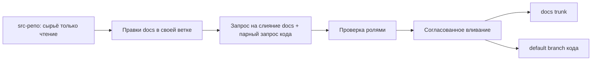

---
title: Руководство аналитика по docs-репозиторию
order: 4
---

Как день за днём вести аналитику сервиса **файлами в формате Markdown в GitLab**. Где размещать тексты, как оформить
правку и пройти проверку коллег.

Подробные правила — в соседних файлах; здесь — практический вход.

Миграция с Confluence в Doc-as-Code (этапы, парные docs / src) —
[roadmap миграции](roadmap-doc-as-code-migration.md). Летопись Confluence и сырьё — в **src-репо**, не в docs remote
и не в ветке `history` внутри docs.

**Оглавление:** [1. С чего начать](#1-с-чего-начать) · [2. Зачем этот гайд](#2-зачем-этот-гайд) ·
[3. Карта репозитория](#3-карта-репозитория) · [3.1 Локально с несколькими репо](#31-локально-с-несколькими-репо) ·
[4. Типичный рабочий день](#4-типичный-рабочий-день) · [5. Что писать в docs](#5-что-писать-в-docs) ·
[6. Ревью](#6-ревью-и-чек-лист-запроса-на-слияние) · [7. Особые случаи](#7-особые-случаи) ·
[8. Проблемы](#8-если-что-то-пошло-не-так) · [9. Куда смотреть дальше](#9-куда-смотреть-дальше)

---

## 1. С чего начать

**Окружение ПО** (Git, VS Code, плагины OpenAPI, Python, утилиты) — сначала
[Окружение и настройка](environment-setup.md). Без этого дальше трудно клонировать репозиторий и править YAML.

Если вы ранее **не использовали** в работе подобные инструменты — ещё две короткие статьи для получения общей
информации:

| Если… | Читайте |
| - | - |
| Непонятны ветка, коммит, push, запрос на слияние | **[Старт с Git](git-start.md)** |
| Непонятно, зачем документация в Git, а не только в Confluence / Word | **[Docs as code](https://gitlab.gboteam.ru/ED/eco-techbook/-/blob/master/architecture/concepts/doc-as-code.md)** |

Дальше — этот гайд. Словарь сокращений — [terms.md](terms.md).

Этот гайд опирается на:

- [git-workflow.md](https://gitlab.gboteam.ru/ED/eco-techbook/-/blob/master/cookbook/analytics/git-workflow.md) — ветки,
коммиты, запросы на слияние, ревью

- [conventions.md](https://gitlab.gboteam.ru/ED/eco-techbook/-/blob/master/standards/analytics/conventions.md) — язык,
ID, слои, открытые вопросы

- [repo-topology.md](https://gitlab.gboteam.ru/ED/eco-techbook/-/blob/master/standards/analytics/repo-topology.md) — где
аналитика относительно кода; парные **docs-** / **src-**

Остальные ссылки — [в конце](#9-куда-смотреть-дальше).

---

## 2. Зачем этот гайд

Аналитика сервиса в ECO живёт **файлами Markdown в отдельном репозитории GitLab** (docs-репозиторий). Это не
«единственная истина на странице wiki» и не полный комплект требований внутри репозитория кода. Исходные документы
(сырьё для восстановления из источников, reverse) — в **парном src-репозитории**.

| Где | Простыми словами |
| - | - |
| **Docs-репо** (`docs-…`) | Чистовик для людей: бизнес- и системные требования, экраны, матрица; **состав remote ограничен**; доступ — аналитики + разработка + QA |
| **Src-репо** (`src-…`) | Выгрузки, черновики, летопись Confluence, открытые вопросы / отчёты при необходимости; **состав свободный**; доступ — **только аналитики**; без обязательных `gpb-manifest` / `CODEOWNERS` |
| **Общие нормы** (eco-techbook, eco-kb, toolkit) | Нормы, гайд, скиллы и шаблоны — отдельные репозитории; в docs-репо сервиса не дублируют |
| **Код** (backend / frontend) | Реализация и файлы API в YAML (OpenAPI / AsyncAPI) |

Готовый комплект (**чистовик**), который читают коллеги и можно **перенести**, лежит в `<service-id>/docs/` внутри
docs-репо. Черновики и выгрузки — в **src-репо** (читаете как сырьё, не правите как чистовик). Внутри чистовика нет
ссылок на eco-techbook / eco-kb / toolkit, src-репо, Confluence и код.

**Как это работает:** аналитики правят docs и src; разработку и тестирование подключают к **docs** (чтение/ревью). При
reverse аналитик клонирует парный src (dev/QA src обычно не клонируют).

---

## 3. Карта репозитория

### Дерево папок (docs-репо)

Имена сервисов и каталогов уточняет команда. Смысл папок — по-русски; коды в скобках — для связи с [terms.md](terms.md).

```text
docs-<service-id>/             # или docs-<domain-slug>/ — целевой remote
├── .gitignore                 # что Git не должен коммитить; remote — целевой состав
├── gpb-manifest.json          # паспорт репозитория (обязателен в корне)
├── CODEOWNERS                 # владельцы путей (пока кладёте сами; из team-configs — когда будет CI)
├── README.md
└── <service-id>/
    └── docs/                  # ← чистовой комплект сервиса (переносимый)
        ├── README.md
        ├── service-vision.md      # что за сервис
        ├── glossary.md            # термины домена
        ├── traceability-matrix.md # связи между артефактами
        ├── brd/                   # бизнес-требования
        │   ├── README.md
        │   ├── business-rules.md  # правила
        │   ├── features/          # фичи
        │   └── use-cases/         # сквозные сценарии
        ├── srs/                   # системные требования
        │   ├── data-model/        # данные
        │   ├── process/           # процессы
        │   ├── functions/         # функции
        │   ├── screen-forms/      # экраны
        │   ├── controls/          # проверки
        │   ├── print-forms/       # печатные формы
        │   ├── contract-calls/       # вызовы контрактов: как сервис зовёт внешние АС
        │   ├── internal-contracts/   # контракты СОБСТВЕННЫХ методов сервиса (внутренний контур Экосистемы; реализация — docs/api из кода)
        │   ├── platform-functions.md # вызовы платформы ЭКО
        │   └── rbac.md            # роли и права
        └── api/                   # описание API для людей
```

Состав **целевого docs remote** — по
[repo-topology §3](https://gitlab.gboteam.ru/ED/eco-techbook/-/blob/master/standards/analytics/repo-topology.md#3-состав-целевого-docs-репо)
 (единственный источник перечня): `<service-id>/docs/` + инфра (`README.md`, `gpb-manifest.json`, `CODEOWNERS`,
`.gitignore`). В remote docs **нет** `output/` (не класть в remote; целевой путь
`<service-id>/docs/`), `sources/`, соседних `open-questions.md` / `reports/`. Сырьё, выгрузки,
клоны кода, открытые вопросы (OQ) и отчёты — в **парном src-репо**; обёртки агентов — только на машине аналитика.

- Каждый сервис — под своим `<service-id>/docs/` (не смешивать сервисы в одной куче без префикса сервиса).
  Ссылки на соседний комплект в том же репо допустимы —
  [§ стык с соседним сервисом ECO](#стык-с-соседним-сервисом-eco).
- Базовые описания обмена с **внешними банковскими АС** — в отдельном репозитории:
[docs-external-contracts](https://gitlab.gboteam.ru/EAN/docs-external-contracts); в сервисе — только «как мы это
вызываем» ([§7](#внешние-банковские-ас)).

- Несколько сервисов в одном docs-репозитории — если общие владельцы и доступ (merge / ревью).
  Дополнительно (не обязательно): общая неделимая логика в документации (требования нельзя разнести
  по двум комплектам, не разорвав смысл) — ещё один повод держать сервисы вместе.
  Нет общих владельцев или доступа — отдельные репо. Критерии —
  [repo-topology §5](https://gitlab.gboteam.ru/ED/eco-techbook/-/blob/master/standards/analytics/repo-topology.md#5-несколько-docs-репо).

### Парный src-репо

Рядом с docs живёт **src-репо** той же гранулярности: `src-<service-id>` или `src-<domain-slug>`. Роль — сырьё для
reverse (Confluence-экспорты, черновики, заметки по клонам кода, реестры OQ / отчёты по желанию команды). Состав src
**не нормируется** жёстким деревом: удобная раскладка на усмотрение команды.
В docs remote содержимое src **не** копируют и на него **не** ссылаются из чистовика.
**Доступ к src — только аналитики**
(разработку и QA в список участников не включают).
`gpb-manifest.json` и `CODEOWNERS` для src **не обязательны**.

```text
src-<service-id>/              # состав свободный — пример, не норма
├── README.md                  # часто — профиль источников (пути, version, клоны)
├── confluence/                # срезы / летопись (вместо history-ветки в docs)
├── raw/                       # архив выгрузки
├── drafts/                    # черновики
├── open-questions.md          # опционально — реестр OQ (не в docs remote)
└── reports/                   # опционально
```

Летопись (история выгрузок Confluence) хранят в **src-репо**. Отдельную ветку `history` внутри docs-репо не заводят:
docs — только чистовик в `trunk`.

### Новый docs-репозиторий

Имена и откуда взять идентификаторы —
[именование](https://gitlab.gboteam.ru/ED/eco-techbook/-/blob/master/standards/analytics/repo-topology.md#6-именование-репозиториев)
,
[service-id и domain-slug](https://gitlab.gboteam.ru/ED/eco-techbook/-/blob/master/standards/analytics/repo-topology.md#откуда-взять-service-id-и-domain-slug)
.

1. Выбрать имя `docs-<service-id>` или `docs-<domain-slug>` по topology; создать репозиторий.
2. Положить
[gpb-manifest.json](https://gitlab.gboteam.ru/TEAM/team-configs/-/blob/master/gpb_manifest_guideline_team_info.md) (
`name` = имя репо) и `CODEOWNERS`.
3. Список участников GitLab: группы **аналитиков + разработка (backend/frontend) + тестирование (QA)** —
[gitlab-settings § доступ docs vs src](https://gitlab.gboteam.ru/ED/eco-techbook/-/blob/master/cookbook/analytics/gitlab-settings.md#2-доступ-docs-vs-src).
4. Настроить `.gitignore` под
[целевой состав docs](https://gitlab.gboteam.ru/ED/eco-techbook/-/blob/master/standards/analytics/repo-topology.md#3-состав-целевого-docs-репо)
 (что Git не должен коммитить: сырьё, IDE-обёртки и всё, чего нет в целевом remote;
в remote попадает только `<service-id>/docs/` + инфра).
5. Настроить GitLab по
[чеклистам нового репо](https://gitlab.gboteam.ru/ED/eco-techbook/-/blob/master/cookbook/analytics/gitlab-settings.md#10-чеклисты-нового-репо).
6. Регистрация в [team-configs](https://gitlab.gboteam.ru/TEAM/team-configs)
   (репо состава команд; оттуда CI кладёт `CODEOWNERS`) — **пока не нужна**: CI ещё нет.
   `CODEOWNERS` кладёте в корень сами (шаг 2).
7. Выложить дерево целевого remote (выше): корень + `<service-id>/docs/`.
8. Одна общая ветка `trunk`, короткие ветки под задачи —
[git-workflow.md](https://gitlab.gboteam.ru/ED/eco-techbook/-/blob/master/cookbook/analytics/git-workflow.md).

### Новый src-репозиторий

Парный к docs с той же гранулярностью (`src-<service-id>` / `src-<domain-slug>`).

1. Создать репозиторий с именем `src-…`.
2. Список участников: **только аналитики** (разработку и QA не добавлять) —
[gitlab-settings § доступ docs vs src](https://gitlab.gboteam.ru/ED/eco-techbook/-/blob/master/cookbook/analytics/gitlab-settings.md#2-доступ-docs-vs-src).
3. **`gpb-manifest.json` и `CODEOWNERS` не обязательны**; регистрация в team-configs как у docs — не требуется.
4. Жёсткого дерева папок **нет**: положить профиль источников (часто корневой `README.md` по
[шаблону toolkit](https://gitlab.gboteam.ru/drcs/drcs-ai-toolkit/-/blob/master/skills/create-artifact/references/sources-readme.md)
, адаптировать под src) и выгрузки так, как удобно команде.
5. Не пушить сырьё в docs remote «временно» — место сырья всегда src.

### API: для программ и для людей

Контракт API нельзя держать только в wiki.

| Нужно… | Где |
| - | - |
| Изменить путь метода (path), поле, обязательность (для программ) | YAML в **backend** |
| Объяснить поведение метода, связи с экраном и функцией | Markdown в **docs** (`docs/api/…`) |
| Найти связь артефактов с операцией | Матрица + идентификатор операции (`operationId` / channel) |

Работают **одна задача Jira** и два связанных запроса на слияние (docs + backend), без отдельного «замка» между
репозиториями —
[repo-topology](https://gitlab.gboteam.ru/ED/eco-techbook/-/blob/master/standards/analytics/repo-topology.md#8-как-стыковать-yaml-в-backend-и-markdown-в-docs-репо)
. Не держать два разных YAML и не оставлять единственную истину только в Confluence. Практика правок в backend —
[§7](#api-в-backend).

### 3.1. Локально с несколькими репо

На машине обычно несколько **клонов рядом** (отдельные каталоги = отдельные git-репозитории). Карта «что где живёт» —
[repo-topology](https://gitlab.gboteam.ru/ED/eco-techbook/-/blob/master/standards/analytics/repo-topology.md); ниже —
как с этим работать день за днём.

**Онбординг ПО:** [Окружение и настройка](environment-setup.md) — до или параллельно клонам.

Пример раскладки (имена каталогов — по соглашению команды):

```text
~/work/
  docs-open-add-account/          # docs-репо; комплект: open-add-account/docs/
  src-open-add-account/           # src-репо; выгрузки / черновики / OQ (состав свободный)
  eco-kb/                         # гайд, terms, git-start, environment-setup
  eco-techbook/                   # общие нормы (conventions, topology, gitlab-settings…)
  drcs-ai-toolkit/                # скиллы и шаблоны; после clone — install (см. ниже)
  docs-external-contracts/     # базовые контракты внешних АС
  ms-<service>/                   # backend — если трогаете API / реализацию
  eco-<service>/                  # frontend — если трогаете UI-смысл
```

| Репо | Зачем клонировать | Кто | GitLab |
| - | - | - | - |
| docs-open-add-account | Писать/ревьюить комплект (`open-add-account/docs/`) | аналитики, разработка, QA | `docs-<service-id>` |
| src-open-add-account | Reverse: выгрузки, летопись, черновики, OQ | **только аналитики** | парный `src-<service-id>` |
| eco-kb | Гайд, окружение ПО, terms, git-start | по задаче | `https://gitlab.gboteam.ru/ED/eco-kb.git` |
| eco-techbook | Читать/править стандарты аналитики | по задаче | `https://gitlab.gboteam.ru/ED/eco-techbook.git` |
| drcs-ai-toolkit | Скиллы ИИ + шаблоны; обязателен install | аналитики (install) | `https://gitlab.gboteam.ru/drcs/drcs-ai-toolkit.git` |
| docs-external-contracts | Базовые контракты EXTINT / примеры внешних АС | по задаче | URL из topology / команды |
| ms-… / eco-… | По задаче: API YAML или UI | разработка / по задаче | соответствующие backend/frontend репо |

**Минимум для аналитика docs:** `docs-…` + `eco-kb` + `drcs-ai-toolkit` (install). Парный **`src-…`** — когда
нужен reverse или работа с выгрузками. `eco-techbook` — когда нужны нормы ID/топология/GitLab или правки стандартов.
Backend/frontend/EXTINT — только если задача их касается.

Состав docs remote —
[topology §3](https://gitlab.gboteam.ru/ED/eco-techbook/-/blob/master/standards/analytics/repo-topology.md#3-состав-целевого-docs-репо)
. Клоны кода для reverse — **отдельные** репозитории рядом (или как договорилась команда в src), не папки внутри docs.

| Нужно сделать… | В каком клоне | Что коммитить |
| - | - | - |
| Текст требований, экраны, матрица, карточка вызова EXTINT | **docs-…** | `<service-id>/docs/…` |
| Выгрузки / летопись Confluence, черновики, OQ | **src-…** | по раскладке команды (состав свободен) |
| Процесс «день за днём», terms, git-start | **eco-kb** | `analytics/…` |
| Установка Git/VS Code/Python/утилит | **eco-kb** | **environment-setup.md** |
| Схема ID, topology, gitlab-settings, conventions | **eco-techbook** | `standards/analytics/…`, `cookbook/analytics/…` |
| Скилл, шаблон артефакта, agent | **drcs-ai-toolkit** | `skills/…`, `agents/…` |
| Путь метода, поля, схемы API (API First) | **backend** (`ms-…`) + cookbook howto | YAML; практика — [api-first-analyst-howto](https://gitlab.gboteam.ru/ED/eco-techbook/-/blob/master/cookbook/analytics/api-first-analyst-howto.md) |
| Правка экрана как реализации UI | **frontend** (`eco-…`) | код UI |
| Базовый контракт внешней АС | **docs-external-contracts** | базовая карточка / примеры |

### Скиллы в IDE

Базовая IDE стека аналитика — **VS Code** ([Окружение и настройка](environment-setup.md)). Скиллы лежат в
[drcs-ai-toolkit](https://gitlab.gboteam.ru/drcs/drcs-ai-toolkit). После клонирования репозитория **drcs-ai-toolkit**
установите скиллы по инструкции
[docs/installation.md](https://gitlab.gboteam.ru/drcs/drcs-ai-toolkit/-/blob/master/docs/installation.md)
(скрипт `./scripts/install.sh`; при необходимости
`npx skills add https://gitlab.gboteam.ru/drcs/drcs-ai-toolkit.git`). Не копировать скиллы в каждый docs-репо вручную.

**Ритм:** одна Jira; в **каждом** затронутом репо — своя ветка и свой MR. Коммиты разных клонов не смешивать. Если
меняется поведение, которое реализуют в коде — согласованный merge docs + код ([§4](#4-типичный-рабочий-день),
[git-workflow: одна общая ветка `trunk`](https://gitlab.gboteam.ru/ED/eco-techbook/-/blob/master/cookbook/analytics/git-workflow.md#долгоживущие-ветки--trunk-based-development-tbd)
).

---

## 4. Типичный рабочий день

Общая ветка репозитория — `trunk` (в неё не пишут напрямую). Своя работа — в короткой ветке → запрос на слияние (MR) →
проверка → вливание.

Если меняется поведение, которое **реализуют в коде**, вливание в docs-`trunk` делают **согласованно** с
вливанием в default branch репозитория кода (часто `trunk` по ADR-0017):



Только правка текстов без реализации (опечатка, meta, выгрузки AS-IS в src, заглушка) — достаточно docs-`trunk`
(и при необходимости отдельный MR в src). Подробнее —
[git-workflow](https://gitlab.gboteam.ru/ED/eco-techbook/-/blob/master/cookbook/analytics/git-workflow.md#долгоживущие-ветки--trunk-based-development-tbd)
.

### Шаги

Если Git новый — снова [git-start.md](git-start.md). Полные правила имён веток и коммитов —
[git-workflow.md](https://gitlab.gboteam.ru/ED/eco-techbook/-/blob/master/cookbook/analytics/git-workflow.md).

1. Обновить `trunk`, создать ветку под задачу (часто с ключом Jira).
2. Править файлы под `<service-id>/docs/…` (в IDE или иначе — правила те же).
3. Сохранить снимок (коммит) → отправить на GitLab (push) → открыть **запрос на слияние** в `trunk`.
4. Заполнить описание, отметить роли проверки, отправить
[записку в чат](https://gitlab.gboteam.ru/ED/eco-techbook/-/blob/master/cookbook/analytics/git-workflow.md#записка-для-команды)
.

5. Дождаться проверки. Если есть парный запрос кода в репо **`docs-*`** (включая
docs-external-contracts): дождаться **уведомления QA**, что задача поступила к
тестированию → затем влить docs одним коммитом (squash).
6. До совместного вливания разработчик читает **ваш запрос / ветку** и Jira, а не «уже всё из docs-`trunk`».
   **QA** при поступлении задачи уведомляет аналитика в чат (⚠️ — влить MR) — только для
   репо `docs-*`, не для `src-*` / кода / общих репо норм.

**Docs-only** (без парного кода и **без** сигнала QA) — правки только в docs, без новой
реализации в BE/FE: опечатки (`fix/…`), методология / инфра (`meta/…`), выгрузки AS-IS,
заглушки EXTINT / каркас ID с пометкой «ещё не в код». Их вливают после ревью, не дожидаясь
QA. Список —
[git-workflow](https://gitlab.gboteam.ru/ED/eco-techbook/-/blob/master/cookbook/analytics/git-workflow.md#когда-можно-без-кода-и-без-сигнала-qa)
; сигнал QA —
[кейс](https://gitlab.gboteam.ru/ED/eco-techbook/-/blob/master/cookbook/analytics/git-workflow.md#4-задача-поступила-к-qa--merge-в-docs-)
.

Пример недели: в понедельник открыты docs и backend; в среду закрыты проверки; когда задача
ушла к QA — аналитик влил docs; код уже в default branch (часто `trunk`) или в том же окне.

### Конфликт при слиянии с trunk

1. Подтянуть `trunk` в свою ветку.
2. В **матрице связей** не брать целиком «только свою» сторону — объединить строки.
3. Проверить ссылки, закоммитить, push. Подробно —
[git-workflow](https://gitlab.gboteam.ru/ED/eco-techbook/-/blob/master/cookbook/analytics/git-workflow.md#3-конфликты-в-git)
.

Feature-ветка — **короткоживущая**. Большую задачу дробить на несколько коротких
запросов на слияние, **если возможно**: тогда так же делят задачу Jira и срез
передачи в разработку / релиз (один ключ — один согласованный кусок поставки).
Пока ждут парный код, запрос может жить дольше — в описании ссылка на парный MR.

---

## 5. Что писать в docs/

### Два слоя

| Слой | Папка | О чём |
| - | - | - |
| Бизнес-требования | `docs/brd/` | Правила, фичи, сценарии |
| Системные требования | `docs/srs/` | Данные, процессы, экраны, функции, проверки, права, интеграции, печатные формы |

Концепция сервиса, глоссарий и матрица связей — в **корне** `docs/` (общие для обоих слоёв).

В текстах слоёв **нельзя** ссылаться друг на друга файлами: стык только через **матрицу**. Подробно —
[conventions.md](https://gitlab.gboteam.ru/ED/eco-techbook/-/blob/master/standards/analytics/conventions.md) §5.4. Один
человек часто ведёт оба слоя — это нормально ([terms.md](terms.md) — роли).

### Откуда берёте содержание

| Ситуация | Как работать |
| - | - |
| Уже есть комплект, нужна доработка | Правите текущий `<service-id>/docs/` (основной режим, *delta*) |
| Пишете с нуля по постановке | Без опоры на старые выгрузки (*forward*) |
| Восстанавливаете из выгрузок | Читаете **src-репо** (профиль + выгрузки); пишете чистовик в `<service-id>/docs/` (*reverse*). Папки `sources/` **внутри docs нет** |

**Старт reverse:** 1) клон docs + парный **src**; 2) профиль источников в src (часто `README.md`) по
[шаблону toolkit](https://gitlab.gboteam.ru/drcs/drcs-ai-toolkit/-/blob/master/skills/create-artifact/references/sources-readme.md)
; 3) выгрузки и при необходимости клоны кода рядом; 4) первый артефакт в `<service-id>/docs/`. Без профиля в src reverse
не начинать.

Факты из выгрузок фиксируйте в **теле коммита или запроса на слияние** («Откуда взяты факты:»), не ссылками на
Confluence / src внутри чистовика. Неясности — **не** как TODO в тексте `docs/`; реестр открытых вопросов при
необходимости ведут в **src-репо** (в docs remote отдельного `open-questions.md` нет) —
[conventions](https://gitlab.gboteam.ru/ED/eco-techbook/-/blob/master/standards/analytics/conventions.md) §6.

### Порядок наполнения (ориентир)

1. Корень `docs/`: vision → glossary.
2. Бизнес-слой: правила → фичи / сценарии.
3. Системный слой: данные → процессы → функции → экраны → проверки / права / печатные формы / интеграции → api.
4. Матрица — **в том же** запросе на слияние, что и затронутые идентификаторы.

Шаблоны файлов — в
[drcs-ai-toolkit/skills/…/references/](https://gitlab.gboteam.ru/drcs/drcs-ai-toolkit/-/tree/master/skills). Список тип
→ шаблон и скиллы для ИИ — там же; в этом гайде таблицу не дублируем.

### Правила чистовика (кратко)

Полный текст —
[conventions.md](https://gitlab.gboteam.ru/ED/eco-techbook/-/blob/master/standards/analytics/conventions.md) §4–§6.

- Принятие результата — через запрос на слияние / Jira, **не** полем «статус» в шапке файла.
- Язык документов — русский; имена файлов — латиница (`id-название.md`).
- В `docs/` нет ссылок на Confluence, src-репо, общие репо норм, код.
- Сырьё в src не правят «как чистовик» (кроме оговорённого профиля / README).
- При смене путей или ID — обновить матрицу и реестры папок в той же ветке.

Переименование: предпочтительно `git mv`, потом поправить ссылки и матрицу.

---

## 6. Ревью и чек-лист запроса на слияние

Кого звать на ревью и на что смотреть —
[git-workflow.md](https://gitlab.gboteam.ru/ED/eco-techbook/-/blob/master/cookbook/analytics/git-workflow.md#8-ревью).
Настройки ролей в GitLab —
[gitlab-settings.md](https://gitlab.gboteam.ru/ED/eco-techbook/-/blob/master/cookbook/analytics/gitlab-settings.md#4-approval-rules)
. Автор **сам себя не утверждает**.

Желательно закрыть проверку за **один рабочий день**. В замечании: причина + что сделать; блокирующее vs пожелание.

### Перед созданием запроса

- [ ] Ветка от свежего `trunk`; в имени — ключ задачи Jira (если задача есть).
- [ ] В чистовике нет ссылок на Confluence / код / src-репо / общие репо норм / другой docs-репо.
- [ ] В MR docs нет сырья (`sources/`, `output/`, соседних OQ/reports) — только `<service-id>/docs/` + инфра.
- [ ] Имена файлов и шапка файла по conventions; идентификаторы не дублируются.
- [ ] При новых или изменённых ID — матрица обновлена **в этом же** запросе.
- [ ] Нет запрещённых ссылок между бизнес- и системным слоем в телах; стык — матрица.
- [ ] Пробелы — не TODO в тексте `docs/`; при необходимости реестр OQ в src, не обязательный файл в docs remote.
- [ ] В теме коммита — ключ Jira; при выгрузках — «Откуда взяты факты:».
- [ ] Локально просмотрены Markdown и ссылки.

### После создания запроса

- [ ] Заголовок `KEY-12345: …`; цель — `trunk`.
- [ ] Нет соавторства ИИ в запросе и коммитах.
- [ ] Отмечены роли проверки; назначены reviewers.
- [ ] Указан парный запрос кода **или** исключение (только docs: fix / meta / AS-IS / заглушка).
- [ ] Записка ушла в чат команды.
- [ ] Перед вливанием закрыты обсуждения; при реализации — вливание вместе с кодом.

Пример записки —
[git-workflow](https://gitlab.gboteam.ru/ED/eco-techbook/-/blob/master/cookbook/analytics/git-workflow.md#записка-для-команды)
.

---

## 7. Особые случаи

### Внешние банковские АС

Базовые контракты обмена (протокол, параметры, примеры) — в общем репозитории внешних контрактов:

[docs-external-contracts](https://gitlab.gboteam.ru/EAN/docs-external-contracts)
`https://gitlab.gboteam.ru/EAN/docs-external-contracts`

В сервисе — карточка **как сервис вызывает** (`srs/contract-calls/`): как *этот* сервис вызывает контракт. Ссылки на
базовый контракт — **только абсолютные** URL GitLab.

| Задача | Где править |
| - | - |
| Сервис начинает звать уже описанный контракт | Карточка вызова в сервисе + строка «Потребители» в общем репо |
| Новый контракт / новая АС | Сначала базовый контракт в общем репо, потом карточка вызова |
| Ломающее изменение базового контракта | Общий репо + обновление карточек вызова у **всех** потребителей |
| Только маппинг на данные/процесс сервиса | Только карточка вызова |

Формат карточек и чеклисты —
[conventions.md](https://gitlab.gboteam.ru/ED/eco-techbook/-/blob/master/standards/analytics/conventions.md) §5.1.1;
ветки в общем репо — префикс `extint/…` —
[git-workflow](https://gitlab.gboteam.ru/ED/eco-techbook/-/blob/master/cookbook/analytics/git-workflow.md#git-в-docs-external-contracts)
. Вливание базового контракта **не** означает «уже можно кодировать»:
сигнал к реализации — контур **сервиса-потребителя**.
Сигнал QA → merge аналитиком действует и для общего репо внешних контрактов (`docs-*`) —
[кейс](https://gitlab.gboteam.ru/ED/eco-techbook/-/blob/master/cookbook/analytics/git-workflow.md#4-задача-поступила-к-qa--merge-в-docs-)
.

### Стык с соседним сервисом ECO

Соседний сервис ECO — не внешняя банковская АС (ТЕССА, ЕСК, …): для тех базовый контракт в общем репозитории
внешних контрактов выше.

- Один docs-репо: из своего `docs/` можно относительной ссылкой на `<другой-service-id>/docs/…`.
- Разные docs-репо: на чужой `docs/` не ссылаются. Нужен стык — своя карточка интеграции
  (можно заглушку); Jira/MR соседа — в описании задачи, не в теле чистовика.

Критерии колокации и выноса —
[repo-topology §5](https://gitlab.gboteam.ru/ED/eco-techbook/-/blob/master/standards/analytics/repo-topology.md#5-несколько-docs-репо).

### API в backend

Кратко «где YAML / где текст» — [§3](#api-для-программ-и-для-людей). Когда меняется файл API в YAML:

- Файл спецификации — в backend (`api-specification/…`), не главная копия YAML в docs.
- Смысл для людей изменился → парный запрос в docs, одна Jira, согласованное вливание.
- Согласование контракта **до** реализации (аналитик + backend + frontend + QA).
- В docs — повествование «зачем метод»; в YAML — поля для программ (`summary`, `operationId`, схемы).

Детали модулей, критерии готовности к взятию в работу (DoR) / критерии готовности (DoD),
conventional commits в BE —
[api-design](https://gitlab.gboteam.ru/ED/eco-techbook/-/blob/master/cookbook/analytics/api-design.md),
[api-standards](https://gitlab.gboteam.ru/ED/eco-techbook/-/blob/master/standards/common/api-standards.md); здесь не
копируем.

### ИИ-помощник в IDE

Помощник, не автор коммитов: те же conventions и git-workflow. Commit / push / merge делаете вы; перед отправкой
смотрите diff. Регламент агента —
[toolkit/agents/](https://gitlab.gboteam.ru/drcs/drcs-ai-toolkit/-/tree/master/agents/).

---

## 8. Если что-то пошло не так

| Симптом | Что сделать |
| - | - |
| Случайно закоммитили в `trunk` | Остановить; откат по правилам репозитория; дальше только ветка + запрос на слияние |
| В чистовике ссылки на Confluence / src-репо | Убрать; источники — в коммите или описании запроса |
| Нет ключа Jira в ветке или коммите | Исправить до вливания; ключ не выдумывать |
| Два сервиса вперемешку без `<service-id>/` | Разнести по `<service-id>/docs/` |
| Сырьё / `sources/` / `output/` попало в docs remote | Убрать из docs; перенести в src; проверить `.gitignore` |
| Матрица не обновлена при новых ID | Дописать в том же запросе |
| Ссылки между бизнес- и системным слоем в телах | Убрать; связь только через матрицу |
| Долгая ветка, тяжёлый конфликт | Подтянуть `trunk`; в матрице не «только моё»; в следующий раз дробить работу |
| Правили общие нормы только у себя в docs-репо | Нормы — в eco-techbook / eco-kb / toolkit; в docs сервиса — только комплект `<service-id>/docs/` |
| Неясно, куда YAML API | Целево — backend; в docs — описания; стыковка — topology |
| Docs влили в `trunk` раньше кода | Откат / уточняющий запрос; дальше — согласованное вливание |

---

## 9. Куда смотреть дальше

Новичкам (Git / docs as code) — [§ 1. С чего начать](#1-с-чего-начать).

| Документ | Зачем |
| - | - |
| [terms.md](terms.md) | Сокращения и термины |
| [git-workflow.md](https://gitlab.gboteam.ru/ED/eco-techbook/-/blob/master/cookbook/analytics/git-workflow.md) | Ветки, коммиты, MR, ревью |
| [conventions.md](https://gitlab.gboteam.ru/ED/eco-techbook/-/blob/master/standards/analytics/conventions.md) | Язык, ID, слои, открытые вопросы |
| [repo-topology.md](https://gitlab.gboteam.ru/ED/eco-techbook/-/blob/master/standards/analytics/repo-topology.md) | Docs / src относительно кода; имена репо; [§3 состав docs](https://gitlab.gboteam.ru/ED/eco-techbook/-/blob/master/standards/analytics/repo-topology.md#3-состав-целевого-docs-репо) |
| [gitlab-settings.md](https://gitlab.gboteam.ru/ED/eco-techbook/-/blob/master/cookbook/analytics/gitlab-settings.md) | Protected branches, approval rules |
| [gpb-manifest.json](https://gitlab.gboteam.ru/TEAM/team-configs/-/blob/master/gpb_manifest_guideline_team_info.md) | Образец манифеста |
| [Шаблоны toolkit](https://gitlab.gboteam.ru/drcs/drcs-ai-toolkit/-/tree/master/skills) | Шаблоны артефактов |
| [docs-external-contracts](https://gitlab.gboteam.ru/EAN/docs-external-contracts) | Базовые контракты внешних АС |
| [ai-sdlc.md](https://gitlab.gboteam.ru/drcs/drcs-ai-toolkit/-/blob/master/docs/ai-sdlc.md) | Зачем строгий формат комплекта (опционально) |

Смежные документы (правила docs здесь не дублируем):
[Doc-as-code](https://gitlab.gboteam.ru/ED/eco-techbook/-/blob/master/architecture/concepts/doc-as-code.md) ·
[ADR-0017](https://gitlab.gboteam.ru/ED/eco-techbook/-/blob/master/architecture/adr/0017-trunk-based-development.md) ·
[проектирование API](https://gitlab.gboteam.ru/ED/eco-techbook/-/blob/master/cookbook/analytics/api-design.md).
