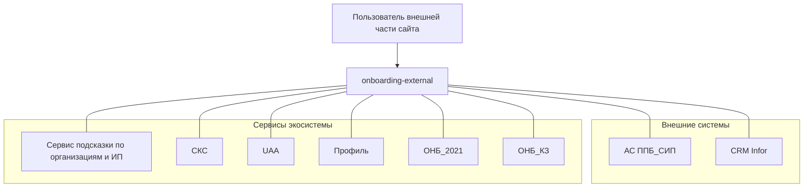

# Концепция сервиса (Service Vision)

## Назначение

Сервис даёт посетителю внешней части сайта возможность удалённо оформить заявку на открытие первого счёта и зарегистрироваться — доводит его от интереса на лендинге или в письме-приглашении до зарегистрированного пользователя с созданной заявкой либо передаёт в подходящий сервис для продолжения оформления.

## Целевая группа

Потенциальные клиенты банка, ещё не работающие в ГПБ Бизнес-Онлайн: посетители лендингов и сайтов партнёров, сайта банка (раздел МСБ) и получатели ссылок-приглашений из электронной почты. Приходят по собственному решению — без предварительной авторизации; часть начинает оформление удалённо (по ссылке с идентификатором удалённого открытия) и продолжает по короткой ссылке на странице регистрации.

## Акторы

- **Пользователь** (посетитель внешней части сайта, будущий клиент) — заполняет данные организации/ИП и заявителя, даёт согласия, подтверждает номер телефона, авторизуется.
- **Системный актор** (автоматическая обработка, без человека) — перенаправления между формами и сервисами, обработка отсутствующих страниц, проверка возможности удалённого открытия, маршрутизация по профилю.
- **Актора банка в контуре сервиса нет** — обработка заявок силами сотрудников Банка находится вне контура этого сервиса.
- **Внешние системы** (вне периметра сервиса; определения — [глоссарий](glossary.md)): АС ППБ_СИП (лиды), CRM Infor.
- **Сервисы экосистемы**: сервис подсказки по организациям и ИП, сервис коротких ссылок (СКС), сервис регистрации пользователей (UAA), сервис Профиль (регистрация и авторизация пользователя), сервис открытия 1-го счёта клиента (ОНБ_2021), сервис открытия счетов клиентам МСБ (ОНБ_КЗ).

## Клиентская и банковская части

Сервис состоит из клиентского контура и автоматической обработки. В идентификаторах комплекта контуры обозначаются суффиксами **CL** (клиент), **BNK** (банк) и **SYS** (системные функции без UI); карта обозначений — [README комплекта](README.md#условные-обозначения).

| Часть | Актор | Роль в жизненном цикле |
|-------|--------|-------------------------|
| **Клиентская** | Пользователь внешней части сайта | Заполняет данные организации/ИП и заявителя, подтверждает номер телефона, авторизуется и доводит оформление до заявки |
| **Банковская** | — | Банковской части у сервиса нет |
| **Автообработка** | Системный актор | Обрабатывает отсутствующие страницы (направляет на форму оформления), выполняет проверки и переходы между сервисами |

## Потребности (исходы)

- Оформить заявку на открытие первого счёта онлайн.
- Продолжить удалённо начатое открытие счёта по короткой ссылке без повторного ввода данных.
- Уйти на авторизацию, сохранив введённые данные организации, и продолжить после входа.

## Ключевые возможности

1. Приём данных организации или ИП — по подсказкам или ручным вводом, с проверкой реквизитов.
2. Выбор типа счёта из предлагаемого перечня.
3. Регистрация заявителя с подтверждением номера телефона по СМС-коду.
4. Удалённое открытие счёта по ссылке-приглашению с переходом по короткой ссылке на страницу регистрации.
5. Авторизация в ГПБ Бизнес-Онлайн с сохранением введённых данных организации и маршрутизация оформления по профилю пользователя.

Детали — в [спецификациях фич](brd/features/README.md) и реестрах SRS.

## Границы

**В охвате:**

- Формы внешней части сайта: ввод данных организации/ИП (с подсказками и без), данные заявителя, подтверждение номера телефона.
- Регистрация пользователя и подтверждение телефона.
- Обработка отсутствующих страниц сервиса (направление на форму оформления).
- Ссылки-приглашения удалённого открытия счёта и переход по короткой ссылке на страницу регистрации.
- Настраиваемая доступность сервиса и подсказок; скрытие типов счетов ГОЗ настройкой.

**Вне охвата:**

- Создание и ведение заявки на открытие счёта — сервис ОНБ_2021 (процесс создания заявки) и сервис ОНБ_КЗ / ОНБ_МСБ (Короткая заявка).
- Аутентификация пользователя — сервис Профиль (ЭФ «Аутентификация по логину и паролю»); сервис направляет пользователя туда и обратно.
- Работа сотрудников Банка с заявками — банковской части у сервиса нет.

## Условия доступности сервиса

Базовое условие доступности — настройка сервиса `onboardingExternal.enabled`: при выключенной настройке формы оформления недоступны, и пользователь направляется на аутентификацию в ГПБ Бизнес-Онлайн. Отдельные возможности управляются своими настройками: подсказки по организациям (`onboardingExternal.dadataEnabled`) и показ типов счетов ГОЗ (`disableGOZ`). Значения настроек — в [справочниках и параметрах](srs/data-model/dictionaries.md); проверки полей форм — в [контролях](srs/control/README.md).

**Сценарий 1. Публичное оформление без авторизации:**
- статус клиента — потенциальный клиент, авторизация до завершения оформления не требуется;
- рамочный договор — сервисом не проверяется, определяется при создании заявки в смежном сервисе;
- соглашение сверх рамочного — сервисом не проверяется, определяется при создании заявки в смежном сервисе;
- соглашение, по которому пользователь — уполномоченное лицо, — сервисом не проверяется, определяется при создании заявки в смежном сервисе;
- руководитель (ЕИО) и/или доверенность — сервисом не проверяются, определяются при создании заявки в смежном сервисе.

Условия, проверяемые после передачи пользователя в смежные сервисы (создание заявки, Короткая заявка), определяются правилами этих сервисов и находятся вне контура. Проверка соответствия профиля требованиям Короткой заявки выполняется автоматически по ОГРН организации из подсказок.

## Бизнес-цели (исходы, измеримость)

- **Новые клиенты с внешнего сайта:** посетитель лендинга или сайта партнёра и получатель ссылки-приглашения доходит до создания заявки на открытие первого счёта. Измеритель — доля начатых оформлений, завершившихся созданием заявки, в разрезе сайта партнёра и акции (Целевое значение — не задано).
- **Удалённое открытие по ссылке:** пользователь, перешедший по ссылке удалённого открытия счёта, после подтверждения данных организации и согласия направляется на страницу регистрации по короткой ссылке. Измеритель — доля таких переходов, завершившихся переходом по короткой ссылке (Целевое значение — не задано).
- **Продолжение после авторизации:** пользователь, выбравший вход в ГПБ Бизнес-Онлайн, продолжает оформление без повторного ввода данных организации. Измеритель — доля авторизаций, после которых создана заявка (Целевое значение — не задано).

## Контекстная диаграмма

